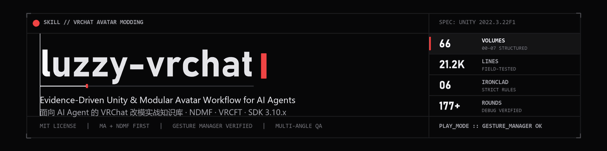

<div align="center">



<br />

[](LICENSE)
[](https://unity.com/)
[](https://modular-avatar.nadena.dev/)
[](https://creators.vrchat.com/)
[](references/README.md)

[简体中文](README.md) · **English**

> **A field-tested Agent Skill for Unity & VRChat Avatar workflows (Claude Code / Codex / Qoder / OpenCode)**
> From zero-to-ready toolchain setup, declarative Modular Avatar modding, face tracking, skinning & clipping repairs, to multi-angle visual verification and VRChat SDK publish forensics.

</div>

---

> [!IMPORTANT]
> **Attribution & Provenance**
> This repository builds upon open-source MIT-licensed skills led by [URaux/vrchat-avatar-modding-skill](https://github.com/URaux/vrchat-avatar-modding-skill) and related community knowledge bases. `references/00-基底/` preserves the upstream MIT core alongside official doc verification notes, while **59 topic volumes** across `01–07` synthesize official Modular Avatar documentation (67 pages), VRChat SDK 3.10.x behavior, community guides, and **177+ rounds of hands-on Unity troubleshooting**. All upstream sources and video/doc references are credited in [ACKNOWLEDGEMENTS.md](ACKNOWLEDGEMENTS.md).

> [!NOTE]
> **Documentation Language Note**
> The internal skill entrypoint ([SKILL.md](SKILL.md)) and the 66 reference volumes under `references/` are authored primarily in **Simplified Chinese** while keeping all Unity C# APIs, component names, shader properties, parameter names, and Editor log tags in **English**. Modern coding agents parse and execute them seamlessly across languages.

> [!WARNING]
> **Content Boundary Notice**
> Certain sections document technical wiring, constraint alignment, and troubleshooting for third-party intimate/interactive Unity prefabs (e.g., SPS, RealKiss, PCS). All documentation is strictly technical and contains no media or commercial avatar assets.

---

## Table of Contents

- [Why luzzy-vrchat?](#why-luzzy-vrchat)
- [Core Philosophy: Six Ironclad Rules](#core-philosophy-six-ironclad-rules)
- [5-Step Multi-Angle Verification Pipeline](#5-step-multi-angle-verification-pipeline)
- [Knowledge Architecture (66 Volumes)](#knowledge-architecture-66-volumes)
- [Quick Start: Plug Into Your AI Agent](#quick-start-plug-into-your-ai-agent)
- [Quick Symptom Routing](#quick-symptom-routing)
- [Repository Layout](#repository-layout)
- [Path Placeholders & Portability](#path-placeholders--portability)
- [Contributing](#contributing)
- [Acknowledgements & License](#acknowledgements--license)

---

## Why luzzy-vrchat?

Modifying VRChat avatars inside Unity is notorious for silent build-time mutations and deceptive Editor previews:

- **What you see in Scene View is often a lie**: Modular Avatar components such as `ObjectToggle`, `MaterialSetter`, `MeshCutter`, and `MergeAnimator` only evaluate during Play mode, Manual Bake, or SDK build—causing AI agents to misdiagnose clipping and mistakenly deform or shrink body meshes.
- **Zero Console errors ≠ working avatar**: Stripped animation curves (`NO VALID ANIMATIONS`), Expression Parameter 256-bit overflow, `saved` flag overrides on defaults, and `unityVersion` bundle collisions never throw red compiler errors.
- **Unverified guesses break avatars in motion**: Without bounding-box math, bone-rebind checks under Walk/Run animations, and multi-angle image inspection, agents easily ship outfits that look fine in T-pose/Idle and float away the moment the user moves.

`luzzy-vrchat` encodes **headless Unity automation, NDMF/MA semantics, Gesture Manager simulation harnesses, multi-angle RenderTexture verification, and VRChat API bundle-alignment recipes** into concrete rules and deterministic checklists.

---

## Core Philosophy: Six Ironclad Rules

[SKILL.md](SKILL.md) enforces six non-negotiable operational rules on every avatar task:

| # | Ironclad Rule | Why It Matters |
| :---: | :--- | :--- |
| **1** | **Split MA components into Bake-time vs. Edit-time; never edit blind** | `ObjectToggle` / `MaterialSetter` / `MaterialSwap` / `MeshCutter` / `MergeAnimator` apply at Play / Bake / Upload; `ShapeChanger` and `BlendshapeSync` reflect in Edit mode. Always bake or enter Play before judging visual bugs. |
| **2** | **Never shrink the body mesh to hide clipping** | Outfits are sculpted for specific base body shapes. Activate the shrink blendshape referenced by `BlendshapeSync` instead of distorting topology or deleting limbs. |
| **3** | **Publishing is a user action—never automate account upload blindly** | SDK login, final Build & Publish confirmation, and credential actions belong to the human user. Scripts prepare a clean, validated scene state ready to upload. |
| **4** | **Prefer Modular Avatar (+ NDMF) over VRCFury** | Declarative MA components are inspectable, previewable, and cleanly reversible. Only fall back to VRCFury when MA has no equivalent or an asset strictly requires it. |
| **5** | **Finish every edit with exhaustive Gesture Manager Play testing** | Install Gesture Manager in every project; enter Play mode, click **every** added/modified radial menu item (no sampling), capture screenshots, and visually verify state changes. Console logs alone never count. |
| **6** | **Rebind bones & verify locomotion on every new/ported outfit or prop** | Cross-avatar garments, tails, gloves, and props must remap `SkinnedMeshRenderer.bones`, `rootBone`, and `bindposes`, then pass `Walk`/`Run` motion checks while toggled ON. |

---

## 5-Step Multi-Angle Verification Pipeline

For any rigging, accessory, garment, or prop task, `luzzy-vrchat` mandates the full pipeline documented in [07-08-multi-angle-binding-verification.md](references/07-验证与排查/07-08-multi-angle-binding-verification.md):

```text
  [1. Numeric Audit] ──▶ [2. Offline Multi-View] ──▶ [3. Visual Checklist] ──▶ [4. Live Scene Check] ──▶ [5. Baked Output Audit]
   World bone delta <1mm   Front/Side/Back/Close-up   Fit/Float/Clip/Scale       Foreground SceneView       Menu / Params / FX
   BakeMesh world bounds   FOV28 · +Z camera rule     Downscale ≤420px inspect   Gizmos OFF capture         NO VALID ANIMATIONS
```

---

## Knowledge Architecture (66 Volumes)

All files follow a uniform **`NN-MM-<slug>.md`** naming scheme across **66 volumes** (**21,200+ lines / 1.7 MB** of structured technical notes—see [references/README.md](references/README.md)):

| Directory | Domain | Volumes | Key Topics Covered |
| :--- | :--- | :---: | :--- |
| [00-基底](references/00-基底/) | **Core Foundations (MIT)** | **7** | Headless `[DidReloadScripts]` flag runners, MA code patterns, PhysBone tuning, VRCFT normalization, Blender mesh bisect/shrinkwrap, core troubleshooting matrix |
| [01-环境与工具链](references/01-环境与工具链/) | **Environment & Toolchain** | **6** | Unity 2022.3.22f1, ALCOM / vrc-get, VPM mirrors, SDK 3.10.6 upgrades, Unity MCP stdio (`6400`) vs HTTP (`8080`) bridge diagnostics |
| [02-工程组织与工作流](references/02-工程组织与工作流/) | **Project & Workflow** | **11** | MA conversion habits, MA↔VRCFury mapping, GUID-safe `MoveAsset` reorg, Setup Outfit internals, RK Player / RealKiss / GUN1 prop integration |
| [03-菜单与参数](references/03-菜单与参数/) | **Menus & Parameters** | **7** | Expression Parameters 256-bit math, `saved` quadrant rules, built-in parameter collisions, reflection menu builders, one-click outfit mutex matrices |
| [04-外观与表情](references/04-外观与表情/) | **Appearance & Face Tracking** | **9** | lilToon shaders & variants, 8×8 gesture slots, MA reactive components & `Inverted` polarity, VRCFT OSC repair, SDK 3.10.6+ Native Face Tracking |
| [05-动骨与穿模](references/05-动骨与穿模/) | **Dynamics, Skinning & Fitting** | **11** | Cross-avatar garment fitting (NewFit / Kabsch), head-swap anatomy, SPS/tail/glove migration, all 17 MA bone/geometry components, `bindPoses` & invalid normals |
| [06-构建上传与备份](references/06-构建上传与备份/) | **Build, Upload & Recovery** | **6** | Reflection-assisted build & publish, AssetRipper project recovery, `unityVersion` variant bundle collision PUT alignment, credential & client cache forensics |
| [07-验证与排查](references/07-验证与排查/) | **Verification & Troubleshooting** | **9** | NDMF bake audits, 7-tier evidence hierarchy, automated Gesture Manager state-machine testing, scene bone recovery, 5-step multi-angle verification |

> [!TIP]
> **Context-efficient retrieval**: Rather than loading entire volumes into an LLM prompt, search with `rg` (ripgrep) and read targeted line ranges:
> ```bash
> rg -n "NO VALID ANIMATIONS|Duplicate|ObjectToggle" references/
> ```

---

## Quick Start: Plug Into Your AI Agent

### Option 1: Install into your Agent's Skills Directory (Recommended)

Clone this repository into the `skills` directory of Claude Code, Codex, Qoder, or OpenCode:

<details>
<summary><b>Show clone commands for Windows & macOS / Linux</b></summary>

```powershell
# Windows (PowerShell)
git clone https://github.com/LuzzyMeow/luzzy-vrchat.git "$env:USERPROFILE\.claude\skills\luzzy-vrchat"
# Or for Codex / Qoder:
git clone https://github.com/LuzzyMeow/luzzy-vrchat.git "$env:USERPROFILE\.codex\skills\luzzy-vrchat"
```

```bash
# macOS / Linux (Bash)
git clone https://github.com/LuzzyMeow/luzzy-vrchat.git ~/.claude/skills/luzzy-vrchat
```

</details>

### Option 2: Reference from Project `AGENTS.md` / `CLAUDE.md`

Add a single directive to your Unity VRChat project's `AGENTS.md`:

```markdown
- For any VRChat Avatar modding, Modular Avatar setup, face tracking, clipping repair, or upload debugging, read `luzzy-vrchat/SKILL.md` first and enforce its Six Ironclad Rules and 5-Step Multi-Angle Verification Pipeline.
```

### Recommended Toolchain Baseline

- **Unity**: `2022.3.22f1` (VRChat supported LTS)
- **Package Manager**: [ALCOM](https://github.com/vrc-get/vrc-get) or VRChat Creator Companion
- **Core Packages**: VRChat SDK Avatars `3.10.x` · Modular Avatar `1.18.x` · NDMF `1.14.x` · Gesture Manager `3.9.x`
- **AI Editor Bridge (Optional)**: [Unity MCP (`com.coplaydev.unity-mcp`)](https://github.com/CoplayDev/unity-mcp) configured over **stdio (`127.0.0.1:6400`)**

---

## Quick Symptom Routing

| Symptom / Failure Mode | Direct Reference |
| :--- | :--- |
| Black face / pink shaders / duplicate shader override / palette mismatch | [00-07 Troubleshooting](references/00-基底/00-07-troubleshooting.md) · [07-01 §33](references/07-验证与排查/07-01-bake-and-validation.md) |
| Clipping / black hole chest / knee poke-through / glove fingertips / pocket sink | [00-05 Mesh & Blendshape](references/00-基底/00-05-mesh-blendshape.md) · [05-01 §12–§15](references/05-动骨与穿模/05-01-outfit-fit-and-clipping.md) · [05-11 Skinning Repair](references/05-动骨与穿模/05-11-skinning-binding-and-geometry-repair.md) |
| Missing menu / dead toggle / inverted `ObjectToggle` polarity / outfit leftovers | [04-06 §14 Polarity Semantics](references/04-外观与表情/04-06-ma-reactive-components.md) · [03-06 §18–§19](references/03-菜单与参数/03-06-ma-menu-build-by-reflection.md) |
| >256-bit parameter overflow / `duplicate definition` / `saved` overwriting defaults | [03-01 §8–§10 EP Authority](references/03-菜单与参数/03-01-parameter-and-menu-audit.md) |
| Dead face tracking / inverted eyelids / frozen horizontal gaze / vanishing eye highlights | [04-08 OSC FT](references/04-外观与表情/04-08-face-tracking-osc-and-repair.md) · [04-09 Native FT](references/04-外观与表情/04-09-face-tracking-native-sdk.md) · [04-07 Prefix Repair](references/04-外观与表情/04-07-vrcft-parameter-prefix-repair.md) |
| Green upload log yet old avatar in-game / stale cache forensics / auth errors | [06-05 Version Collision](references/06-构建上传与备份/06-05-avatar-package-version-collision.md) · [06-06 Client Forensics](references/06-构建上传与备份/06-06-upload-credentials-and-client-evidence.md) |
| Unity MCP reports `No Unity Editor instances found` | [01-06 §3–§4 MCP Bridge](references/01-环境与工具链/01-06-project-launch-and-mcp-bridge.md) · [07-09 §8 Fallbacks](references/07-验证与排查/07-09-dynamic-verification-and-evidence-recipes.md) |

---

## Repository Layout

```text
luzzy-vrchat/
├── SKILL.md                     # Skill entrypoint: project conventions, 6 ironclad rules, routing tables
├── README.md                    # Simplified Chinese README
├── README.en.md                 # English README (this file)
├── ACKNOWLEDGEMENTS.md          # Upstream repos, video series, official docs, and MIT notices
├── LICENSE                      # MIT License
├── assets/
│   └── banner.svg               # Repository hero banner
└── references/
    ├── README.md                # Full index of all 66 volumes, naming rules, legacy map & open gaps
    ├── 00-基底/                  # (7 vols)  Upstream MIT core + official doc addenda
    ├── 01-环境与工具链/           # (6 vols)  Unity / ALCOM / VPM / MCP bridge
    ├── 02-工程组织与工作流/        # (11 vols) MA workflows, asset reorg, interactive plugin wiring
    ├── 03-菜单与参数/             # (7 vols)  EP rules, reflection menus, MMD & platform sync
    ├── 04-外观与表情/             # (9 vols)  lilToon, gestures, MA reactive components, OSC & Native FT
    ├── 05-动骨与穿模/             # (11 vols) PhysBone, cross-avatar fitting, head swap, SPS, skinning
    ├── 06-构建上传与备份/          # (6 vols)  SDK reflection publish, AssetRipper, bundle alignment
    └── 07-验证与排查/             # (9 vols)  Bake audits, automated GM testing, 5-step multi-angle QA
```

---

## Path Placeholders & Portability

To keep every guide portable across workstations, local paths are normalized using placeholders:

| Placeholder | Meaning | Resolution |
| :--- | :--- | :--- |
| `<PROJECT_ROOT>` | Active Unity project root | Directory containing `Assets/`, `Packages/`, and `ProjectSettings/` |
| `<VRCHAT_ROOT>` | VRChat workspace root | `VRCHAT_ROOT` env var (parent of `projects/`, `resources/`, `tools/`) |
| `<UNITY_EXE>` | Unity Editor executable | Path to `2022.3.22f1\Editor\Unity.exe` |
| `<USERPROFILE>` | Windows user home directory | `%USERPROFILE%` |
| `<CACHE_ROOT>` | VRChat disk cache directory | Configured cache path (defaults under `LocalLow\VRChat\VRChat`) |

---

## Contributing

Issues and Pull Requests with reproducible Unity logs, screenshots, or updated SDK behavior are warmly welcome:

1. **Tag Evidence Clearly**: Record exact Unity / SDK / MA versions and test dates; separate verified findings from `NOT_RUN` items (see `07-02`).
2. **Write Structured Knowledge**: Merge new troubleshooting findings directly into the matching topic volume under `references/01–07` (`NN-MM-<slug>.md`) in `Symptom → Root Cause → Fix → Criteria` format.
3. **Sanitize Local Data**: Never commit hardcoded drive letters, personal usernames, private Blueprint IDs, or VRChat auth cookies/tokens.
4. **Keep Indexes Synced**: When adding a new volume, update both [references/README.md](references/README.md) and [SKILL.md](SKILL.md), and register external sources in [ACKNOWLEDGEMENTS.md](ACKNOWLEDGEMENTS.md).

---

## Acknowledgements & License

- **Upstream & Community**: Built on MIT-licensed foundations from [URaux](https://github.com/URaux/vrchat-avatar-modding-skill), [felixchaos](https://github.com/felixchaos/vrchat-avatar-modding-skill), [NeonSaya](https://github.com/NeonSaya/VRCAvatarOutfitMenuSkill), [XiaoboooOvO](https://github.com/XiaoboooOvO/VRChatEditorSkill), and [sthsmall](https://github.com/sthsmall/vrc-modding), plus official docs from Modular Avatar, NDMF, lilToon, VRCFaceTracking, and VRChat creators. Full attributions live in [ACKNOWLEDGEMENTS.md](ACKNOWLEDGEMENTS.md).
- **License**: Released under the [MIT License](LICENSE).

<div align="center">
<sub>Crafted with field-tested Unity logs, RenderTexture screenshots, and Modular Avatar workflows.</sub>
</div>
