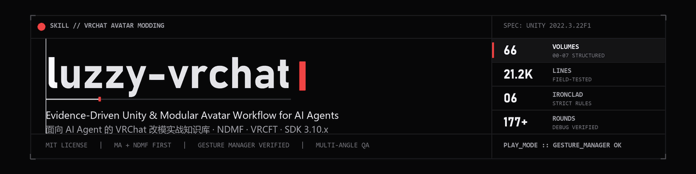

<div align="center">



<br />

[](LICENSE)
[](https://unity.com/)
[](https://modular-avatar.nadena.dev/)
[](https://creators.vrchat.com/)
[](references/README.md)

**简体中文** · [English](README.en.md)

> **面向 AI Coding Agent（Claude Code / Codex / Qoder / OpenCode）与 VRChat 改模工程的实战级 Skill**
> 从零环境搭建、Modular Avatar 声明式改模、面部追踪、蒙皮绑定与穿模修复，到多角度视觉验证与 SDK 上传取证的完整操作手册。

</div>

---

> [!IMPORTANT]
> **开源传承与说明（Attribution）**
> 本仓库基于 [URaux/vrchat-avatar-modding-skill](https://github.com/URaux/vrchat-avatar-modding-skill)（MIT）等开源工作流沉淀而来：`references/00-基底/` 完整保留上游 MIT 原文并附官方校验补充节；`01–07` 共 **59 册**主题分册则结合了 Modular Avatar 67 页官方文档对齐、VRChat SDK 3.10.x 实测、社区教程梳理以及 **177+ 轮真实改模排错记录**。全部上游与参考来源均集中记录在 [ACKNOWLEDGEMENTS.md](ACKNOWLEDGEMENTS.md)。

> [!WARNING]
> **内容边界提示**
> 本知识库部分章节涉及第三方成人向/亲密互动插件（如 SPS / RealKiss / PCS）的技术排查与绑定说明，仅限 Unity 组件接线、约束定位与安全合规的技术记录，不包含任何媒体或商业模型资产。

---

## 目录

- [为什么需要 luzzy-vrchat](#为什么需要-luzzy-vrchat)
- [核心工作哲学：六条铁律](#核心工作哲学六条铁律)
- [多角度独立验证五件套](#多角度独立验证五件套)
- [知识架构与 66 册分册全景](#知识架构与-66-册分册全景)
- [快速开始：接入你的 AI Agent](#快速开始接入你的-ai-agent)
- [高频症状快速路由](#高频症状快速路由)
- [目录结构](#目录结构)
- [占位符与环境约定](#占位符与环境约定)
- [参与贡献与维护规范](#参与贡献与维护规范)
- [致谢与许可证](#致谢与许可证)

---

## 为什么需要 luzzy-vrchat

在 Unity 中改造 VRChat Avatar 极易踩中「静态假象」与「隐性构建期改写」的陷阱：

- **编辑器所见非所得**：Modular Avatar 的 `ObjectToggle`、`MaterialSetter`、`MeshCutter`、`MergeAnimator` 等在普通 Scene 视图下根本不生效，Agent 很容易误判「穿模」或「没挂上」而胡乱修改网格或缩身体。
- **Console 无报错 ≠ 功能正常**：曲线路径丢帧（`NO VALID ANIMATIONS`）、Expression Parameters 超出 256-bit 预算、`saved` 覆盖默认值、`unityVersion` 多包版本分叉都不会抛红色 Error。
- **AI 容易只靠口头推断交付**：没有数值包围盒校验、没有移动态绑骨验证、没有多角度视觉读图，极易交付一个「Idle 勉强能看、Walk 就原地飞走」的半成品。

`luzzy-vrchat` 把 **Unity Editor 自动化、Modular Avatar / NDMF 语义、Gesture Manager 模拟测试、多角度截图判读、以及 VRChat 服务端版本对齐** 全部固化为 AI 可直接执行的规则、C# 代码范式与检查清单。

---

## 核心工作哲学：六条铁律

[SKILL.md](SKILL.md) 定义了 AI 在接手任何 VRChat 改模任务时必须遵守的六条硬约束：

| # | 铁律 | 核心机制与原因 |
| :---: | :--- | :--- |
| **1** | **区分两类 MA 组件，禁止对着未 Bake 视图瞎改** | `ObjectToggle` / `MaterialSetter` / `MaterialSwap` / `MeshCutter` / `MergeAnimator` 仅在 Play / Manual Bake / 上传时生效；`ShapeChanger` 与 `BlendshapeSync` 在编辑态实时生效。验证视觉问题前必须先 Bake 或进 Play。 |
| **2** | **禁止靠缩身体来修穿模** | 服装网格按特定身体形态雕琢；应激活 `BlendshapeSync` 指向的对应遮盖 Blendshape（如 `Shrink_*` / `Knee_OFF`），保留作者原始拓扑与菜单逻辑。 |
| **3** | **上传是用户动作，人机分工明确** | 涉及账号登录、SDK Build & Upload 二次确认与最终发布均交由用户完成；自动化脚本负责产出一个干净、通过校验的可上传场景状态。 |
| **4** | **实现方式 Modular Avatar（+ NDMF）绝对优先** | 开关、换装、参数、动画合并一律优先用声明式的 MA 组件实现，可读、可回滚、可预览；仅在 MA 无等价件或原作者强制依赖时才保留 VRCFury。 |
| **5** | **收尾必跑 Gesture Manager 逐项轮盘实测** | 新工程必装 Gesture Manager；改完必须进入 Play 模式逐个点击新增/修改的轮盘菜单（不抽样），截图并经视觉模型读图确认状态真实切换，仅看 Console 不算数。 |
| **6** | **新增/转换模型与衣装必须实际绑骨 + 移动态验收** | 跨模型服饰、尾巴、手套、道具必须按基础骨名重写 `SkinnedMeshRenderer.bones` 与 `rootBone` / `bindposes`，并在开启菜单后切换 `Walk` / `Run` 验证跟随不飞脱。 |

---

## 多角度独立验证五件套

对于任何涉及绑骨、配饰、衣装与道具的改动，`luzzy-vrchat` 强制要求执行 [07-08 多角度独立验证标准流程](references/07-验证与排查/07-08-multi-angle-binding-verification.md)，拒绝「单张正视图」蒙混过关：

```text
  [1. 数值量测] ──▶ [2. 离线多角度渲染] ──▶ [3. 视觉逐项判读] ──▶ [4. 实机窗口复核] ──▶ [5. 烘焙产物核验]
   World 骨位差<1mm     正/侧/背 + 局部特写       贴位/浮空/穿模/比例       SceneView 置前抓图       Menu / Params / FX
   BakeMesh 包围盒       FOV28 · +Z 相机铁律        缩图 ≤420px 读图         关闭 Gizmos 核验       NO VALID ANIMATIONS
```

---

## 知识架构与 66 册分册全景

全库采用统一的 **`NN-MM-<slug>.md`** 编号体系，共 **66 册**、超过 **21,200 行 / 1.7 MB** 结构化 Markdown 文档（完整索引见 [references/README.md](references/README.md)）：

| 目录 | 主题领域 | 册数 | 代表内容与覆盖范围 |
| :--- | :--- | :---: | :--- |
| [00-基底](references/00-基底/) | **Core Foundations (MIT)** | **7** | 无头编辑器自动化、`[DidReloadScripts]`、MA 代码范式、PhysBone 调参、VRCFT 归一化、Blender 裁剪、经典黑脸/黑洞根因总表 |
| [01-环境与工具链](references/01-环境与工具链/) | **Environment & Toolchain** | **6** | Unity 2022.3.22f1 / ALCOM / vrc-get、国内镜像源、SDK 3.10.6 升级、Unity MCP stdio(6400) vs HTTP(8080) 桥接排障 |
| [02-工程组织与工作流](references/02-工程组织与工作流/) | **Project & Workflow** | **11** | MA 化操作习惯、MA↔VRCFury 替换矩阵、Safe `MoveAsset` 资产整理、Setup Outfit 机制、RK Player / RealKiss / GUN1 插件集成 |
| [03-菜单与参数](references/03-菜单与参数/) | **Menus & Parameters** | **7** | Expression Parameters 256-bit 审计与 `saved` 四象限、内置参数撞名、反射批量生成菜单、一键穿衣互斥矩阵与混搭持久化 |
| [04-外观与表情](references/04-外观与表情/) | **Appearance & Face Tracking** | **9** | lilToon 属性与变体、狼脸 8×8 手势槽位、MA 反应式组件全家族与 `Inverted` 极性、VRCFT OSC 修复、SDK 3.10.6+ 原生面捕与高光补偿 |
| [05-动骨与穿模](references/05-动骨与穿模/) | **Dynamics, Skinning & Fitting** | **11** | 跨头像服饰重拟合（NewFit / Kabsch）、换头解剖与脖子接缝、SPS / 尾巴 / 手套迁移、MA 17 个骨骼几何组件、`bindPoses` 与法线修复 |
| [06-构建上传与备份](references/06-构建上传与备份/) | **Build, Upload & Recovery** | **6** | SDK 反射出包与发布、AssetRipper 工程逆向恢复、多 `unityVersion` 版本分叉 PUT 对齐、上传凭据排障与客户端本地缓存取证 |
| [07-验证与排查](references/07-验证与排查/) | **Verification & Troubleshooting** | **9** | NDMF 烘焙审计、7 层证据阶梯与资产所有权、Gesture Manager 自动化状态机测试、骨骼污染恢复、多角度验证五件套与 Play 边界配方 |

> [!TIP]
> **结构化检索策略**：本知识库设计了「主入口导航 + 关键词精准检索 + 按需切片读取」的组织方式，建议配合 `rg`（ripgrep）定位行号后按需读取，以节省 Agent 上下文窗口：
> ```bash
> rg -n "NO VALID ANIMATIONS|Duplicate|ObjectToggle" references/
> ```

---

## 快速开始：接入你的 AI Agent

### 方式一：直接克隆到 Agent Skills 目录（推荐）

将本仓库克隆至你所用 AI 客户端的全局或项目级 `skills` 目录即可自动被识别：

<details>
<summary><b>展开各客户端安装路径与命令（PowerShell / Bash）</b></summary>

```powershell
# Windows (PowerShell) — 适用于 Codex / Claude Code / Qoder / OpenCode
# 请按你的工具实际目录调整目标路径，例如：
git clone https://github.com/LuzzyMeow/luzzy-vrchat.git "$env:USERPROFILE\.claude\skills\luzzy-vrchat"
# 或 Qoder / Codex：
git clone https://github.com/LuzzyMeow/luzzy-vrchat.git "$env:USERPROFILE\.codex\skills\luzzy-vrchat"
```

```bash
# macOS / Linux (Bash)
git clone https://github.com/LuzzyMeow/luzzy-vrchat.git ~/.claude/skills/luzzy-vrchat
```

</details>

### 方式二：在工程的 `AGENTS.md` / `CLAUDE.md` 中引用

如果你正在维护自己的 Unity VRChat 工程，可以直接把本技能作为核心参考并在项目指令文件中声明：

```markdown
- 凡涉及 VRChat Avatar 改模、Modular Avatar 配置、面捕、穿模与上传排错，先读取 `luzzy-vrchat/SKILL.md` 并严格遵循其「六条铁律」与「多角度独立验证五件套」。
```

### 配套推荐工具链

- **Unity**：`2022.3.22f1`（VRChat 当前官方推荐基线）
- **包管理器**：[ALCOM](https://github.com/vrc-get/vrc-get) / VRChat Creator Companion
- **核心插件**：VRChat SDK Avatars `3.10.x` · Modular Avatar `1.18.x` · NDMF `1.14.x` · Gesture Manager `3.9.x`
- **AI 桥接（可选）**：[Unity MCP (`com.coplaydev.unity-mcp`)](https://github.com/CoplayDev/unity-mcp) —— 推荐配置为 **stdio (`127.0.0.1:6400`)** 避免多开工程端口冲突

---

## 高频症状快速路由

| 遇到的问题症状 | 推荐直达章节 |
| :--- | :--- |
| 黑脸 / 粉材质 / 同名 Shader 覆盖 / 多色板错配 | [00-07 排查总表](references/00-基底/00-07-troubleshooting.md) · [07-01 §33](references/07-验证与排查/07-01-bake-and-validation.md) |
| 穿模 / 黑洞 / 袜子屈膝穿模 / 手套露指 / 口袋陷入 | [00-05 网格形变](references/00-基底/00-05-mesh-blendshape.md) · [05-01 §12–§15](references/05-动骨与穿模/05-01-outfit-fit-and-clipping.md) · [05-11 蒙皮修复](references/05-动骨与穿模/05-11-skinning-binding-and-geometry-repair.md) |
| 菜单不出现 / 开关失效 / `ObjectToggle` 极性反向 / 混搭残留 | [04-06 §14 极性全解](references/04-外观与表情/04-06-ma-reactive-components.md) · [03-06 §18–§19](references/03-菜单与参数/03-06-ma-menu-build-by-reflection.md) |
| 参数超 256-bit / `duplicate definition` / `saved` 覆盖默认值 | [03-01 §8–§10 EP 权威规则](references/03-菜单与参数/03-01-parameter-and-menu-audit.md) |
| 面捕无反应 / 闭眼极性反了 / 瞳孔不左右动 / 眯眼高光消失 | [04-08 OSC 面捕](references/04-外观与表情/04-08-face-tracking-osc-and-repair.md) · [04-09 原生 FT](references/04-外观与表情/04-09-face-tracking-native-sdk.md) · [04-07 前缀修复](references/04-外观与表情/04-07-vrcft-parameter-prefix-repair.md) |
| 上传全绿但游戏里还是旧模型 / 客户端取证 / 凭据失效 | [06-05 版本碰撞对齐](references/06-构建上传与备份/06-05-avatar-package-version-collision.md) · [06-06 凭据与客户端取证](references/06-构建上传与备份/06-06-upload-credentials-and-client-evidence.md) |
| Unity MCP 报 `No Unity Editor instances found` | [01-06 §3–§4 桥接排障](references/01-环境与工具链/01-06-project-launch-and-mcp-bridge.md) · [07-09 §8 兜底配方](references/07-验证与排查/07-09-dynamic-verification-and-evidence-recipes.md) |

---

## 目录结构

```text
luzzy-vrchat/
├── SKILL.md                     # Skill 入口：项目定位、六条铁律、全流程导航与增量路由
├── README.md                    # 简体中文项目主页（当前文件）
├── README.en.md                 # English documentation
├── ACKNOWLEDGEMENTS.md          # 上游开源仓库、视频教程、官方文档与 MIT 原文汇总
├── LICENSE                      # MIT License
├── assets/
│   └── banner.svg               # 仓库视觉横幅
└── references/
    ├── README.md                # 66 册详细总索引、命名规范、旧名映射与已知缺口清单
    ├── 00-基底/                  # (7 册) 上游 MIT 核心基底 + 官方校验补充
    ├── 01-环境与工具链/           # (6 册) Unity / ALCOM / VPM / MCP 桥接
    ├── 02-工程组织与工作流/        # (11 册) MA 化流程、资产整理、第三方互动插件
    ├── 03-菜单与参数/             # (7 册) EP 规则、反射建菜单、MMD 与平台同步
    ├── 04-外观与表情/             # (9 册) lilToon、手势表情、MA 反应式组件、OSC & 原生面捕
    ├── 05-动骨与穿模/             # (11 册) PhysBone、跨头像换衣、换头、SPS、蒙皮几何修复
    ├── 06-构建上传与备份/          # (6 册) SDK 反射上传、工程逆向、版本对齐与客户端取证
    └── 07-验证与排查/             # (9 册) 烘焙审计、GM 自动化模拟、多角度独立验证五件套
```

---

## 占位符与环境约定

为保持知识库的跨机器可移植性，正文中所有机器相关路径均已抽象为统一占位符，使用前请按本机实际情况解析：

| 占位符 | 含义 | 推荐解析方式 |
| :--- | :--- | :--- |
| `<PROJECT_ROOT>` | 当前 Unity 项目根目录 | 同时包含 `Assets/`、`Packages/`、`ProjectSettings/` 的目录 |
| `<VRCHAT_ROOT>` | VRChat 工作区根目录 | 环境变量 `VRCHAT_ROOT`（管理 `projects/`、`resources/`、`tools/`） |
| `<UNITY_EXE>` | Unity 编辑器可执行文件 | 指向 `2022.3.22f1\Editor\Unity.exe` |
| `<USERPROFILE>` | 当前 Windows 用户目录 | `%USERPROFILE%` |
| `<CACHE_ROOT>` | VRChat 本地缓存根目录 | 用户配置的磁盘缓存位置（默认位于 `LocalLow\VRChat\VRChat`） |

---

## 参与贡献与维护规范

欢迎提交 Issue 或 Pull Request 补充新的实测案例与工具链适配！为保持知识库质量与可追溯性，请遵循以下约定：

1. **实测与证据分层**：每条结论尽量标注版本环境与实测日期，严格区分已验证事实与未验证推断（可参照 `07-02` 的证据阶梯）。
2. **结构化落点**：不按时间堆积「症状补丁」，新排查结论请直接归档至 `references/01–07` 对应主题分册（`NN-MM-<slug>.md`），按「症状 → 根因 → 解法 → 判据」编写。
3. **路径脱敏**：禁止提交硬编码盘符、个人用户名、真实 Blueprint ID（除已公开的脱敏示例外）或任何 VRChat 登录凭据。
4. **三件套同步**：新增独立分册时，请同步更新 [references/README.md](references/README.md) 与 [SKILL.md](SKILL.md) 的导航表；外部参考来源集中登记在 [ACKNOWLEDGEMENTS.md](ACKNOWLEDGEMENTS.md)。

---

## 致谢与许可证

- **上游开源基底**：感谢 [URaux](https://github.com/URaux/vrchat-avatar-modding-skill)、[felixchaos](https://github.com/felixchaos/vrchat-avatar-modding-skill)、[NeonSaya](https://github.com/NeonSaya/VRCAvatarOutfitMenuSkill)、[XiaoboooOvO](https://github.com/XiaoboooOvO/VRChatEditorSkill)、[sthsmall](https://github.com/sthsmall/vrc-modding) 等开源作者，以及 Modular Avatar、NDMF、lilToon、VRCFaceTracking 与中文 VRC 教程创作者。完整名录与出处见 [ACKNOWLEDGEMENTS.md](ACKNOWLEDGEMENTS.md)。
- **许可证**：本仓库遵循 [MIT License](LICENSE) 开源。

<div align="center">
<sub>Crafted with field-tested Unity logs, RenderTexture screenshots, and Modular Avatar workflows.</sub>
</div>
